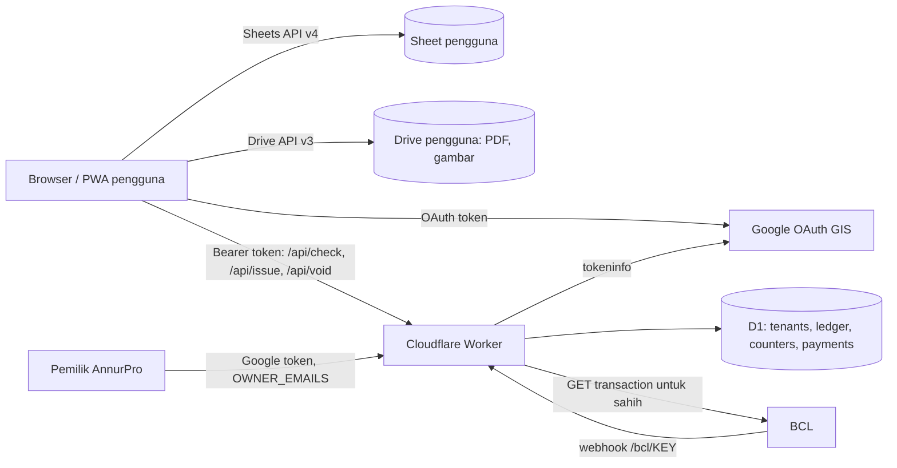

# TRD: Annur Invoice

## 1. Overview
Frontend ialah PWA statik (vanilla JS modules, tiada bundler) yang dihos pada Cloudflare Workers dengan static assets. Browser pengguna bercakap **terus dengan Google Sheets API dan Drive API** menggunakan access token pengguna sendiri (scope `drive.file`), jadi data dokumen tinggal dalam Drive pengguna dan tiada database dokumen di server. Satu Worker kecil (`/api/*`) pula mengurus **perkara yang tak boleh dipercayai pada browser**: semakan kelayakan, penomboran berserial, ledger kredit, webhook bayaran BCL dan dashboard pemilik. Worker menggunakan Cloudflare D1 (SQLite) kerana nombor berserial dan baki kredit perlu atomik.

Ini mengikut pola Annur Time Table (skill `micro-saas-builder`) dengan satu penyimpangan sedar: **D1 menggantikan KV** untuk lesen dan ledger, sebab KV hanya "eventually consistent" dan tidak sesuai untuk kaunter dan baki.

## 2. Technical Goals
- Berfungsi pada telefon dan desktop moden (Chrome, Edge, Safari iOS 16.4+); dipasang sebagai PWA.
- Kos hosting RM0 pada peringkat awal (Cloudflare free plan); kos tetap hanya domain.
- Terbit dokumen < 3 saat (Worker + tulis Sheet + jana PDF + muat naik Drive) pada sambungan 4G; jana PDF di peranti.
- Tahan sehingga ribuan dokumen setahun bagi seorang pengguna; ribuan pengguna pada Worker/D1.
- App boleh dibuka luar talian (shell, tetapan, draf); terbit perlu internet.
- Tiada data dokumen atau data peribadi pelanggan pengguna disimpan di server AnnurPro.

## 3. Technology Stack
| Layer | Teknologi | Fungsi | Sebab dipilih |
|-------|-----------|--------|---------------|
| Frontend | HTML/CSS/JS ES modules, tiada build | UI, borang, pratonton, jana PDF | Boleh deploy terus, mudah di-AI-code, tiada alat build |
| PDF | html2canvas + jsPDF (disalin ke repo, **bukan CDN**) | Jana PDF A4 di peranti | Sudah terbukti pada AZN Invoice; muka surat sepadan pratonton. Had: teks dalam PDF ialah imej (kandungan dirampas); boleh naik taraf ke PDF vektor kemudian |
| Font | Carlito (woff2, self-host) untuk dokumen; system font untuk UI | Rupa dokumen | OFL, metrik sepadan Calibri |
| Backend | Cloudflare Worker (`/api/*`, `/bcl/<key>`) | Lesen, nombor, kredit, webhook, admin | Kos hampir sifar, satu fail, mudah diuji |
| Database platform | Cloudflare D1 | Akaun, langganan, ledger, kaunter, bayaran | Transaksi atomik (`db.batch`), percuma pada skala awal |
| Data pengguna | Google Sheet dalam Drive pengguna | Dokumen, pelanggan, tetapan | Pengguna memiliki data, PDPA lebih ringan, Sheet jadi eksport/sandaran |
| Storan fail | Google Drive (folder aplikasi pengguna) | PDF, logo, cop, tandatangan | `drive.file` hanya nampak fail ciptaan app |
| Auth | Google Identity Services token model | Log masuk, token akses | Tiada kata laluan untuk diurus; tiada client secret |
| Pembayaran | BCL (bcl.my / Bayarcash) | Langganan, pek kredit (FPX, kad) | Sudah digunakan pada Annur Time Table |
| Hosting | Cloudflare Workers + static assets + domain sendiri | App + API | Deploy automatik dari GitHub (Workers Builds) |
| Ujian | `node --test`, Playwright (E2E dengan mock Google/BCL) | Unit dan E2E | Tidak menyentuh akaun sebenar |

## 4. Seni Bina

**Aliran terbit dokumen (ringkas):**
1. Browser hantar `POST /api/issue {docId, type, prefix, date}` dengan Google token.
2. Worker sahkan token, semak kelayakan (langganan aktif **atau** kredit ≥ 5), keluarkan nombor, potong kredit, rekod `doc_issues` dalam **satu `db.batch` atomik**.
3. Browser tulis baris ke Sheet (`values.append`), jana PDF, muat naik ke Drive, kemas kini baris dengan pautan.
4. Jika langkah 3 gagal, nombor kekal milik `docId` itu; browser cuba semula (idempotent) dan `GET /api/issues` membolehkan pendamaian.

## 5. Authentication & Authorization
- **Log masuk:** Google Identity Services (`initTokenClient`), mesti dicetus daripada klik pengguna. Token ~1 jam; papar status "Sambung semula" bukan gagal senyap.
- **Identiti pengguna:** emel Google yang disahkan Worker melalui `https://oauth2.googleapis.com/tokeninfo` (audience mesti sama `GOOGLE_CLIENT_ID`, emel verified). Semua rekod D1 diikat pada emel ini (huruf kecil).
- **Kebenaran:** di Worker. Setiap endpoint `/api/*` menapis data mengikut emel daripada token yang disahkan; client tidak pernah menghantar emel sebagai pengenalan.
- **Pentadbir platform (R-03):** token Google yang emelnya ada dalam `OWNER_EMAILS` (var Worker). Tiada ADMIN_TOKEN yang ditampal dalam console. `ADMIN_TOKEN` rahsia hanya sebagai fallback kecemasan.
- **Staf (R-02, ditangguh):** akses ke Sheet melalui perkongsian Google; kawalan peranan di peringkat data tidak wujud pada model Sheet, jadi peranan staf hanya dikuatkuasa di UI. Dinyatakan dalam privasi dan panduan.
- **Penerima (R-04):** tiada login. Hanya pautan PDF "sesiapa dengan pautan" (lihat seksyen 6).
- **Sesi:** tiada sesi di server. Cache semakan kelayakan di peranti, sah **7 hari** daripada semakan berjaya terakhir untuk emel yang sama supaya gangguan Worker tidak mengunci pengguna.

## 6. Keselamatan
- **Tiada rahsia dalam frontend.** `GOOGLE_CLIENT_ID` ialah awam (diikat pada "Authorized JavaScript origins"). `BCL_API_TOKEN`, `BCL_WEBHOOK_KEY`, `ADMIN_TOKEN` hanya sebagai secret Worker.
- **Webhook BCL tidak bertandatangan:** kunci panjang rawak dalam laluan `/bcl/<BCL_WEBHOOK_KEY>`, dan **sentiasa ambil semula transaksi** daripada API BCL (status berjaya, order dan amaun sepadan) sebelum memberi lesen/kredit. Idempoten melalui `payments.order_no`.
- **Validasi input di Worker:** `type ∈ {invoice, quotation, do}`; `prefix` regex `^[A-Z0-9-]{1,12}$`; `date` format ISO sah; `docId` UUID; had saiz body; pertanyaan D1 sentiasa *prepared statement* (tiada SQL dibina daripada input).
- **CORS:** hanya origin dalam `ALLOWED_ORIGINS`; `cache-control: no-store` untuk respons dinamik.
- **Had kadar:** `POST /api/issue` maksimum 30/minit/emel; `/api/check` 60/minit (D1 atau Cloudflare rate limiting; kaedah tepat perlu disahkan).
- **Pautan PDF:** fail Drive dikongsi "sesiapa dengan pautan boleh lihat" (kebolehan ini dipilih untuk kemudahan kongsi WhatsApp). Pautan tidak boleh diteka tetapi sesiapa yang menerimanya boleh melihat dokumen; dinyatakan dalam panduan. Pilihan "tidak kongsi awam, muat turun sahaja" disediakan dalam Tetapan.
- **Integriti dokumen:** lajur `hash_kandungan` (SHA-256) direkod ketika terbit sebagai bukti kes ubahsuai. Pengguna yang mempunyai akses edit Sheet masih boleh mengubah data; ini had model Sheet dan ditulis dalam panduan.
- **Penguatkuasaan kredit tidak sempurna:** PDF dijana di browser, jadi pengguna mahir boleh menjana PDF tanpa nombor server. Penguatkuasaan berlaku pada **pengeluaran nombor berserial**; kebocoran diterima.
- **PDPA:** Server hanya simpan emel Google, nama perniagaan, tarikh/lesen, ledger kredit, nombor dokumen dan kiraan (tiada kandungan dokumen, tiada data pelanggan pengguna). Data pelanggan kepada pengguna berada dalam Drive pengguna sendiri; pengguna ialah pengawal data bagi pelanggan mereka. Halaman privasi mesti nyatakan: apa disimpan dan di mana; penggunaan data Google mematuhi Google API Services User Data Policy termasuk Limited Use; data pembayaran dikendalikan BCL.
- **Pemadaman:** pengguna boleh minta padam rekod D1 (emel, ledger) melalui sokongan; Sheet dan Drive kekal milik pengguna.
- **Sandaran:** Sheet pengguna ialah salinan data mereka. Platform: D1 Time Travel (tempoh perlu disahkan) + eksport D1 mingguan oleh pemilik (`wrangler d1 export`).

## 7. Had & Kuota Platform (semua **perlu disahkan** dengan dokumentasi semasa sebelum launch)
| Platform | Had relevan | Kesan |
|----------|-------------|-------|
| Google Sheets API | Kuota baca/tulis per minit per pengguna dan per projek | Tulis berkelompok (`batchUpdate`), debounce, cache tetapan; cuba semula dengan backoff pada 429 |
| Google Sheets | 10 juta sel setiap spreadsheet; 50,000 aksara setiap sel | ~35 lajur setiap dokumen → ratusan ribu dokumen; had 100 baris item setiap dokumen supaya `items_json` kekal < 50,000 aksara |
| Google Drive | Kuota storan akaun pengguna sendiri | PDF ~100–400 KB; mampu ribuan dokumen |
| Cloudflare Workers (free) | Permintaan/hari dan CPU per permintaan | Aset statik tidak dikira; panggilan `/api` ringan. Naik ke plan berbayar bila pengguna aktif ramai |
| Cloudflare D1 (free) | Baris dibaca/ditulis sehari, saiz DB | Penggunaan per dokumen: ~5 tulis. Semak bila melepasi ~500 pengguna aktif |
| Google OAuth | Mod Testing: maksimum 100 test users, token tamat 7 hari | Mesti tukar ke Production sebelum jual; verifikasi branding diperlukan |
| BCL | Caj transaksi (andaian RM1 setiap transaksi) | Sebab minimum pek kredit RM10; sahkan caj sebenar |

## 8. Integrasi
- **Google:** OAuth (GIS), Sheets API v4, Drive API v3 (`files.create`, `permissions.create`), tokeninfo.
- **BCL:** borang (Langganan Bulanan, Langganan Tahunan, dan pada v1.1 Pek Kredit RM10/20/50) dengan medan wajib "E-mel Google untuk sistem"; webhook ke `/bcl/<key>`; API baca transaksi untuk pengesahan. Rujuk `references/bcl.md` skill.
- **WhatsApp:** pautan `https://wa.me/?text=` dengan pautan PDF (tiada API).
- **Emel/e-Invois:** tiada dalam v1.

## 9. Deployment & Environment
- **Repo:** repo baharu `annurprosolutions-cell/annur-invoice` (disyorkan *private* untuk melindungi ujian dan sejarah; ambil perhatian bahawa repo private menghentikan GitHub Pages percuma, tidak mengapa kerana hos ialah Cloudflare).
- **Hos:** satu projek Cloudflare Workers dengan `wrangler.jsonc` (`assets.directory = "."`, `run_worker_first: ["/api/*", "/bcl/*"]`), `.assetsignore` mengecualikan `tests/`, `tools/`, `worker/`, `docs/`, `schema.sql`.
- **Binding & env:** D1 `DB`; var `GOOGLE_CLIENT_ID`, `ALLOWED_ORIGINS`, `OWNER_EMAILS`, `BUY_URL_SUB`, `BUY_URL_PACK`, `TRIAL_CREDITS` (50), `CREDITS_PER_DOC` (5), `GRACE_DAYS` (7), `EDIT_WINDOW_HOURS` (24), `BCL_FORM_ID`, `YEARLY_MIN_AMOUNT`, `PACKS` (JSON padanan amaun→kredit), `BCL_ACCEPT_TEST`; secret `BCL_API_TOKEN`, `BCL_WEBHOOK_KEY`, `ADMIN_TOKEN`.
- **Persekitaran:** `staging` (Worker + D1 berasingan, BCL mod ujian) dan `production`.
- **Domain:** domain sendiri pada Worker; `*.workers.dev` dikekalkan untuk semakan. Tambah origin baharu pada OAuth client.
- **Pemilikan akaun:** Cloudflare, Google Cloud (OAuth), BCL, GitHub, Search Console dimiliki akaun AnnurPro Solutions. Rahsia disimpan dalam pengurus kata laluan, 2FA aktif.
- **Rilis:** push ke `main` → Workers Builds deploy ~30 saat. Naikkan `version` dalam `config.js` dan nama cache `sw.js` pada setiap rilis.

## 10. Andaian & Soalan Terbuka
**Andaian:** D1 percuma mencukupi untuk 6 bulan pertama; BCL menyokong item berbilang harga dengan kuantiti seperti pada Annur Time Table; scope `drive.file` boleh digunakan dengan Sheets API untuk fail yang dicipta app (terbukti pada Annur Time Table).

**Soalan terbuka:**
1. Kaedah had kadar Worker yang paling sesuai pada plan semasa?
2. Adakah D1 Time Travel disertakan pada free plan, dan tempohnya?
3. Staf berkongsi dengan `drive.file`: perlu prototaip Google Picker (F-21).
4. Perlukah PDF vektor (teks boleh dipilih) pada versi 2?
5. Kadar SST terkini dan format dokumen wajib bagi syarikat berdaftar (rujuk PRD §8).
