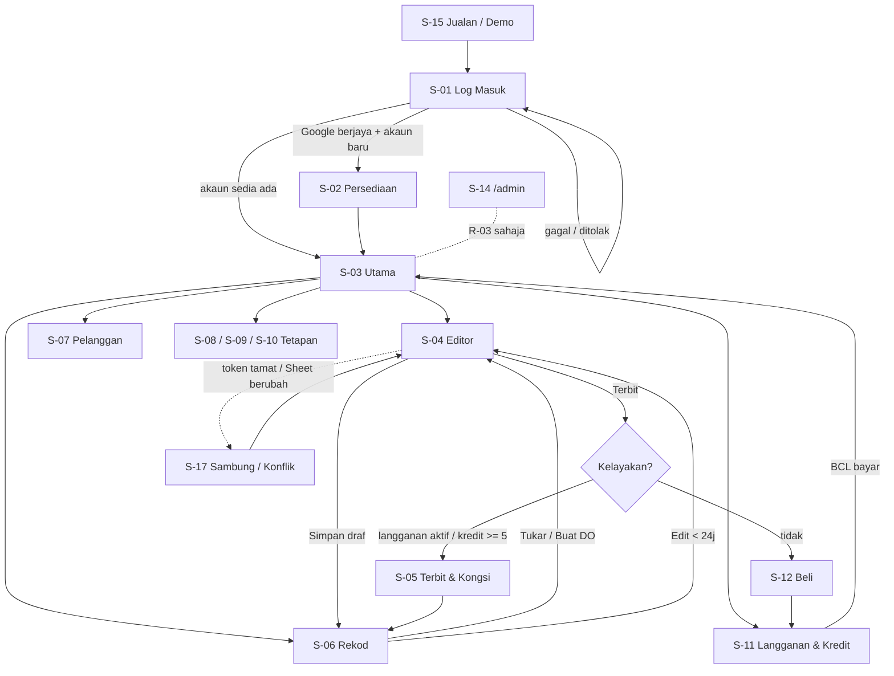

# AFD: Annur Invoice

## 1. Overview
Pengguna baru masuk daripada halaman jualan atau demo, log masuk dengan Google, melalui wizard persediaan sekali sahaja, kemudian bekerja daripada skrin **Utama**: cipta dokumen (Invois, Quotation, DO), terbit, kongsi, dan semak di **Rekod**. Tetapan syarikat, logo/cop/tandatangan, penomboran dan cukai ada dalam **Tetapan**. Bayaran dan baki dalam **Langganan & Kredit**. Pemilik platform ada dashboard berasingan di `/admin/`.

## 2. Senarai Skrin
| ID | Skrin | Role | Feature | Tujuan | Data dipaparkan (rujuk BSD) |
|----|-------|------|---------|--------|-----------------------------|
| S-01 | Log Masuk | R-01 | F-01, F-15 | Sambung Google, mula percubaan | `Meta`; D1 `tenants` (semak kelayakan) |
| S-02 | Persediaan Pertama (wizard) | R-01 | F-02, F-03, F-04, F-05 | Isi syarikat, kod/prefix, logo, cop, tandatangan, bank, SST dengan pratonton | Sheet `Syarikat`, `KodCukai` |
| S-03 | Utama | R-01 | F-12, F-15, F-16, F-17 | Pintasan cipta dokumen, status lesen/baki kredit, dokumen terkini, notis (tamat tempoh, kredit rendah) | `Dokumen` (10 terkini); `/api/check` |
| S-04 | Editor Dokumen | R-01 | F-05, F-07, F-08, F-09, F-10, F-13, F-14 | Isi borang Invois/Quotation/DO + pratonton langsung; simpan draf; terbit | `Dokumen`, `Pelanggan`, `Syarikat`, `KodCukai` |
| S-05 | Dialog Terbit & Kongsi | R-01, R-04 | F-06, F-11 | Sahkan terbit (kos kredit), papar nombor, buka PDF, WhatsApp, salin pautan, muat turun | `doc_issues`; `Dokumen.pdf_url` |
| S-06 | Rekod Dokumen | R-01 | F-10, F-12, F-14 | Senarai, tapis, cari; buka PDF; edit (24 jam); tukar; batal | `Dokumen` + draf tempatan |
| S-07 | Pelanggan | R-01 | F-13 | Senarai, tambah, ubah, arkib pelanggan | `Pelanggan` |
| S-08 | Tetapan: Profil Syarikat | R-01 | F-03 | Ubah maklumat syarikat, bank, penandatangan, warna aksen | `Syarikat` |
| S-09 | Tetapan: Logo, Cop & Tandatangan | R-01 | F-04 | Muat naik, buang latar, drag/nudge/saiz, tandatangan DO | `Syarikat` (id fail, kedudukan); Drive `_Tetapan` |
| S-10 | Tetapan: Dokumen, Penomboran & Cukai | R-01 | F-03, F-05, F-06 | Prefix, nota default, terma, validity, tajuk, kod cukai | `Syarikat`, `KodCukai`, `counters` (baca) |
| S-11 | Langganan & Kredit | R-01 | F-16, F-17, F-18 | Status pelan, tarikh tamat, baki, beli langganan/pek, sejarah kredit | `/api/check`, `/api/ledger` |
| S-12 | Dialog Lesen / Kredit Tidak Cukup | R-01 | F-15, F-16, F-17, F-18 | Halang terbit bila tiada kelayakan; tunjuk pilihan beli | `/api/issue` ralat |
| S-13 | Bantuan & Sokongan | R-01 | F-20 | Panduan ringkas, FAQ, WhatsApp/emel sokongan | statik |
| S-14 | Dashboard Pentadbir Platform (`/admin/`) | R-03 | F-19 | Pelanggan, lesen, kredit, bayaran, log webhook, statistik | D1 semua jadual |
| S-15 | Halaman Jualan & Demo (`/salepage/`, `/?demo`) | R-01 (prospek) | F-20 | Pasarkan, cuba demo tanpa log masuk | statik + data contoh |
| S-16 | Privasi (`/privasi.html`) | semua | F-20 | Dasar privasi (syarat OAuth) | statik |
| S-17 | Dialog Sambungan / Konflik Sheet | R-01 | F-01, F-14 | Sambung semula token, konflik bila Sheet berubah di tempat lain, tulisan tertangguh | `Meta.dikemaskini` |

## 3. Key User Journeys

### Journey A: Pengguna baru hingga dokumen pertama (R-01)
1. Buka halaman jualan S-15, cuba demo, tekan "Cuba percuma".
2. S-01: tekan **Sambung Google**, benarkan scope. Worker `/api/check` cipta akaun dan beri 50 kredit (sekali). Jika gagal: paparan "Tidak dapat semak lesen, cuba lagi".
3. Sistem cipta Sheet dan folder Drive (F-01). Redirect ke S-02.
4. S-02 wizard 5 langkah: (1) nama syarikat, no. SSM, alamat, telefon, emel; (2) kod syarikat 2–6 huruf (cth `AZN`), sistem cadang prefix `AZN`, `AZN-Q`, `AZN-DO`; (3) logo, cop, tandatangan (boleh langkau dan isi kemudian); (4) bank; (5) berdaftar SST? Ya/Tidak. Pratonton dokumen contoh sentiasa kelihatan.
5. Tekan **Siap** → S-03 dengan banner "50 kredit percuma = 10 dokumen".
6. Tekan **Invois Baharu** → S-04 → isi → **Terbit** → S-05 → buka PDF.

### Journey B: Quotation hingga Invois dan DO (R-01)
1. S-04 pilih jenis **Quotation**, pilih pelanggan, isi item, **Terbit** (5 kredit atau percuma jika langganan).
2. Pelanggan setuju. S-06 → tapis Quotation → pada baris itu tekan **Tukar jadi Invois**.
3. S-04 terbuka dengan jenis Invois: Bill To, item, Your Ref (= no. quotation) terisi; tarikh hari ini; nombor akan dikeluarkan ketika terbit. Semak dan ubah jika perlu.
4. **Terbit**. Quotation berstatus "Ditukar → INV/…". Dari S-06 tekan **Buat DO** untuk invois itu: Bill To, item (tanpa harga), PO No terisi; Ship To "sama dengan Bill To" atau isi alamat lain; **Terbit**.

### Journey C: Terbit tanpa kelayakan (R-01)
1. S-04 tekan **Terbit** pada akaun tanpa langganan dan baki < 5 kredit.
2. Worker pulang `403 tiada-kredit`. S-12 papar: "Baki kredit tak cukup (X). Langgan RM20/bulan untuk tanpa had, atau beli kredit." Draf kekal selamat di peranti.
3. Pengguna bayar melalui BCL (tab baru), kembali ke app, tekan **Semak semula**; `/api/check` kemas kini; **Terbit** semula berjaya.

### Journey D: Betulkan dokumen (R-01)
1. S-06 buka dokumen yang diterbit < 24 jam: butang **Edit** aktif; ubah dan **Simpan semula** (nombor sama, tiada kredit baharu; PDF diganti).
2. Selepas 24 jam butang jadi **Batal dokumen**: masukkan sebab, status "Batal", nombor tidak digunakan semula, kredit tidak dikembalikan. Salin sebagai draf baharu untuk terbit dokumen pembetulan.

### Journey E: Tetapan logo/cop/tandatangan (R-01)
1. S-09 pilih **Tukar** pada Cop, pilih gambar, tandakan "Buang latar putih".
2. Seret cop/tandatangan dalam pratonton, gunakan anak panah 1px (Shift = 10px) dan slider saiz; **Simpan**.
3. Dokumen baharu menggunakan kedudukan baharu; dokumen lama (PDF terbit) tidak berubah.

### Journey F: Pemilik platform urus pelanggan (R-03)
1. Buka `/admin/`, log masuk Google (emel dalam `OWNER_EMAILS`).
2. Cari emel pelanggan: lihat pelan, tarikh tamat, baki kredit, dokumen diterbit.
3. Tambah 1/3/12 bulan, laras kredit (dengan sebab), atau semak bayaran dan hantar semula webhook gagal.

## 4. App Flow Diagram

## 5. Navigasi
| Skrin | R-01 | R-03 | Awam / prospek |
|-------|------|------|-----------------|
| Bar bawah (telefon) / sisi (desktop): Utama, Dokumen Baharu (butang +), Rekod, Pelanggan, Tetapan | ya | - | - |
| Tetapan → Profil, Logo/Cop/Tandatangan, Dokumen/Penomboran/Cukai, Langganan & Kredit, Bantuan | ya | - | - |
| Pill status Sheet (Tersimpan / Menyimpan / Sambung semula / Konflik) di atas | ya | - | - |
| `/admin/` | - | ya | - |
| `/salepage/`, `/?demo`, `/privasi.html` | - | - | ya |

## 6. Keadaan Khas
| Skrin | Empty | Loading | Ralat | Mobile vs desktop |
|-------|-------|---------|-------|-------------------|
| S-01 | - | Butang "Menyambung..." | Popup disekat: arahan benarkan popup; akaun DELIMa disekat: cadangkan Gmail | Sama |
| S-03 | "Belum ada dokumen. Cipta yang pertama" + 3 butang | Skeleton kad | Banner "Tidak dapat semak lesen" guna cache 7 hari | Kad menegak di telefon |
| S-04 | Satu baris item kosong | Overlay "Menjana PDF" | Medan wajib merah: Bill To, sekurang-kurangnya satu item bernama; jumlah tidak boleh negatif | Telefon: tab Borang / Pratonton + bar bawah tetap (jumlah, Terbit); Desktop: dua lajur |
| S-05 | - | "Mengeluarkan nombor..." → "Menyimpan..." → "Menjana PDF..." | Nombor sudah dikeluarkan tetapi Sheet/Drive gagal: "Dokumen bernombor INV/… belum disimpan sepenuhnya. Cuba lagi" (idempotent) | Helaian bawah di telefon |
| S-06 | "Tiada dokumen sepadan" | Skeleton senarai | Gagal baca Sheet: butang Cuba lagi | Senarai kad di telefon, jadual di desktop |
| S-07 | "Belum ada pelanggan" | Skeleton | Padanan nama sama: amaran duplikasi | |
| S-09 | Gambar lalai/placeholder | Pemprosesan gambar | Fail bukan gambar / terlalu besar (> 5 MB): mesej | Seret dengan jari; anak panah butang |
| S-11 | Tiada sejarah kredit | Skeleton | Gagal `ledger`: Cuba lagi | |
| S-12 | - | - | Ralat bayaran: arah ke WhatsApp sokongan | |
| S-14 | Tiada pelanggan | Skeleton | Token bukan pemilik: "Akses ditolak" | Desktop diutamakan |
| Luar talian | Semua | - | Banner "Luar talian: draf boleh dicipta, terbit perlukan internet" | |

## 7. Notifikasi & Automasi
- **Dalam app (notis di S-03):** lesen akan tamat (≤ 14 hari amaran, ≤ 3 hari mendesak), tempoh ihsan, lesen tamat, kredit < 10, percubaan hampir habis.
- **Webhook BCL:** bayaran berjaya → aktifkan/lanjut langganan atau tambah kredit tanpa tindakan manual; log dalam `webhook_log`.
- **Tiada emel/WhatsApp automatik** daripada sistem v1. Pemilik platform lihat "Perlu tindakan" di S-14 (webhook gagal, percubaan hampir habis, pembaharuan) dan hubungi manual.
- **Pendamaian:** setiap kali app dibuka, `GET /api/issues?since=` bandingkan dengan Sheet; nombor terbit tanpa baris Sheet ditawarkan "Pulihkan".
