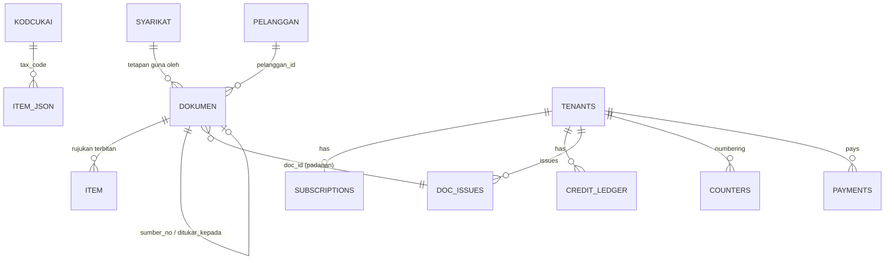

# BSD: Annur Invoice

## 1. Overview
Dua stor data dengan tanggungjawab berbeza:

1. **Sheet + Drive milik pengguna** (dibaca/ditulis terus daripada browser dengan token pengguna): semua kandungan dokumen, pelanggan dan tetapan syarikat. Dipilih supaya pengguna memiliki data mereka, kos platform sifar dan PDPA lebih ringan.
2. **Cloudflare D1 milik AnnurPro** (hanya melalui Worker): perkara yang tak boleh dipercayai pada browser iaitu akaun, langganan, ledger kredit, kaunter nombor dokumen, bayaran. **Tiada kandungan dokumen atau data pelanggan pengguna** di sini.

Semua nama jadual/tab konsisten dengan PRD/AFD (Bahasa Malaysia untuk Sheet, Inggeris `snake_case` untuk D1).

## 2. Data Model

Hubungan merentas stor hanya melalui `doc_id` (UUID) dan `no_dokumen`.

## 3. Jadual / Sheet

### 3A. Sheet pengguna (nama fail: `Annur Invoice – [Nama Syarikat]`)
Penanda carian: fail dicipta dengan `appProperties { annurInvoice: "master" }` supaya boleh dijumpai semula pada peranti lain (jangan cari ikut tajuk). Baris 1 = tajuk lajur; lajur bertanda "(rujukan)" untuk dibaca manusia dan **diabaikan** semasa memuat.

#### `Meta` (Feature: F-01, F-14)
| Field | Jenis | Wajib | Unik | Default | Penerangan |
|-------|-------|-------|------|---------|-----------|
| kunci | text | ya | ya | - | `format`, `dikemaskini`, `oleh`, `aplikasi`, `folder_akar`, `folder_invois`, `folder_quotation`, `folder_do`, `folder_tetapan` |
| nilai | text | ya | tidak | - | `format` = 1 (nombor versi skema); `dikemaskini` = ISO UTC; folder = id Drive |

#### `Syarikat` (Feature: F-02, F-03, F-04) — format kunci/nilai
| Kunci | Jenis | Default | Penerangan / Validasi |
|-------|-------|---------|-----------------------|
| nama | text | - | Wajib, tidak kosong |
| ssm | text | '' | No. pendaftaran |
| tin | text | '' | Pilihan; dipaparkan pada dokumen jika ada |
| brn | text | '' | Pilihan |
| sst_berdaftar | YA/TIDAK | TIDAK | Mengaktifkan lajur cukai pada dokumen |
| sst_no | text | '' | Wajib jika `sst_berdaftar` = YA |
| alamat | text (berbilang baris) | '' | Satu baris = satu baris pada dokumen |
| emel, tel, laman | text | '' | Format emel disemak |
| kod_syarikat | text | - | 2–6 huruf besar/nombor (asas prefix) |
| prefix_invois | text | `{kod}` | Regex `^[A-Z0-9-]{1,12}$` |
| prefix_quotation | text | `{kod}-Q` | sama |
| prefix_do | text | `{kod}-DO` | sama |
| tajuk_invois | text | INVOICE | `INVOICE` atau `TAX INVOICE` |
| bank_nama, bank_akaun, bank_pemegang | text | '' | Dipaparkan pada invois |
| tt_nama, tt_jawatan | text | '' | Penandatangan utama |
| do_tt_nama, do_tt_jawatan, do_tt_tel | text | '' | Kosong = guna penandatangan utama |
| nota_invois_1..3, nota_quotation_1..3, nota_do_1..2 | text | contoh lalai | Nota kaki dokumen |
| terma_default | text | '' | cth `30 DAYS` |
| validity_default | text | `30 DAYS` | Quotation |
| warna_aksen | hex | `#0f172a` | Disahkan `^#[0-9a-fA-F]{6}$` |
| kongsi_awam | YA/TIDAK | YA | Pautan PDF "sesiapa dengan pautan" |
| logo_id, cop_id, tt_gambar_id, do_tt_gambar_id | text | '' | Id fail Drive dalam folder `_Tetapan` (kosong = tiada gambar) |
| cop_x, cop_y, cop_saiz | number | 36, 20, 106 | px dalam ruang tandatangan |
| tt_x, tt_y, tt_lebar | number | 24, 28, 150 | px |
| dikemaskini | ISO | now | Auto |

#### `KodCukai` (Feature: F-05)
| Field | Jenis | Wajib | Unik | Default | Penerangan |
|-------|-------|-------|------|---------|-----------|
| kod | text | ya | ya | - | cth `TIADA`, `SST-JUALAN-10` |
| nama | text | ya | tidak | - | Dipaparkan di dokumen |
| kadar | number | ya | tidak | 0 | Peratus, 0–100, maksimum 2 tempat perpuluhan |
| jenis | enum | ya | tidak | tiada | `tiada`, `sst_jualan`, `sst_perkhidmatan` |
| aktif | YA/TIDAK | ya | tidak | TIDAK | Hanya kod aktif muncul dalam borang |

Seed: `TIADA` 0 (aktif YA); `SST-JUALAN-5` 5, `SST-JUALAN-10` 10, `SST-PERKHIDMATAN-6` 6, `SST-PERKHIDMATAN-8` 8 (aktif TIDAK; diaktifkan bila `sst_berdaftar` = YA). **Kadar perlu disahkan dengan Kastam sebelum launch**; pengguna boleh ubah kadar.

#### `Pelanggan` (Feature: F-13)
| Field | Jenis | Wajib | Unik | Default | Penerangan |
|-------|-------|-------|------|---------|-----------|
| id | uuid | ya | ya | auto | |
| nama | text | ya | tidak | - | Amaran duplikasi jika nama sama (huruf besar, tanpa ruang berlebihan) |
| alamat | text | tidak | tidak | '' | |
| tel | text (format teks) | tidak | tidak | '' | Kolum format teks supaya sifar depan kekal |
| attn | text | tidak | tidak | '' | |
| emel | text | tidak | tidak | '' | |
| tin, brn | text | tidak | tidak | '' | Pilihan |
| arkib | YA/TIDAK | ya | tidak | TIDAK | Arkib, bukan padam |
| dicipta | ISO | ya | tidak | now | |

#### `Dokumen` (Feature: F-06, F-07, F-08, F-09, F-10, F-11, F-12) — satu baris setiap dokumen terbit
| Field | Jenis | Wajib | Unik | Default | Penerangan / Validasi |
|-------|-------|-------|------|---------|-----------------------|
| doc_id | uuid | ya | ya | auto | Sama dengan `doc_issues.doc_id`; kunci kemas kini baris |
| jenis | enum | ya | tidak | - | `invoice`, `quotation`, `do` (boleh dilanjutkan `po` pada F-22) |
| no_dokumen | text | ya | ya | dari Worker | `PREFIX/MMYY-NNN`; tidak boleh diubah pengguna |
| tarikh | text ISO `YYYY-MM-DD` | ya | tidak | hari ini | Dipaparkan `DD/MM/YYYY` |
| status | enum | ya | tidak | Terbit | `Terbit`, `Batal`. "Dikunci" ialah paparan: `Terbit` dan `now − diterbit_pada > 24 jam` |
| status_quotation | enum | quotation | tidak | Menunggu | `Menunggu`, `Ditukar` |
| pelanggan_id | uuid | tidak | tidak | - | Rujuk `Pelanggan.id`; nilai di bawah ialah salinan pada tarikh terbit |
| bill_nama | text | ya | tidak | - | Tidak kosong |
| bill_alamat, bill_tel, attn | text | tidak | tidak | '' | |
| our_ref, your_ref | text | tidak | tidak | '' | `your_ref` boleh nombor PO pelanggan |
| terma | text | tidak | tidak | default | |
| validity | text | quotation | tidak | `30 DAYS` | |
| ship_nama, ship_alamat, ship_attn, ship_tel | text | DO | tidak | = bill | Hanya DO |
| sumber_jenis, sumber_no | text | tidak | tidak | '' | Dokumen asal (tukar/buat DO) |
| ditukar_kepada | text | tidak | tidak | '' | Senarai nombor dipisah koma |
| subtotal | number | invois/quotation | tidak | 0 | Selepas diskaun, sebelum cukai; dua tempat perpuluhan |
| jumlah_cukai | number | sama | tidak | 0 | |
| jumlah | number | sama | tidak | 0 | `subtotal + jumlah_cukai`; ≥ 0 |
| jumlah_perkataan | text | sama | tidak | '' | English, cth `RINGGIT MALAYSIA ONE THOUSAND ... ONLY` |
| jumlah_qty | number | DO | tidak | 0 | |
| bil_item | number | ya | tidak | - | 1–100 |
| items_json | text (JSON) | ya | tidak | - | `[{n, desc, qty, unit, price, disc, tax_code, amount}]`; **sumber kebenaran** item; ≤ 40,000 aksara |
| ringkasan_cukai_json | text (JSON) | tidak | tidak | '' | `[{kod, kadar, asas, cukai}]` |
| pdf_url | text | tidak | tidak | '' | Pautan Drive |
| pdf_id | text | tidak | tidak | '' | Id fail Drive |
| hash_kandungan | text | ya | tidak | - | SHA-256 kandungan kanonik ketika terbit/edit terakhir |
| diterbit_pada | ISO | ya | tidak | now | Daripada Worker (`doc_issues.issued_at`) |
| diterbit_oleh | text | ya | tidak | - | Emel Google |
| dikemaskini_pada | ISO | ya | tidak | now | Edit 24 jam |
| dibatalkan_pada, sebab_batal | text | tidak | tidak | '' | |
| skema | number | ya | tidak | 1 | Versi baris |

Peraturan business:
- `no_dokumen` unik; Worker ialah satu-satunya yang mengeluarkan nombor.
- `qty` > 0 (maksimum 3 tempat perpuluhan); `price` ≥ 0; `disc` antara 0 dan `qty × price`; `amount = round2(qty × price − disc)`.
- Cukai: asas ikut `tax_code`; `cukai_kod = round2(Σ amount_kod × kadar/100)` (pusingan pada peringkat kod, bukan baris); `jumlah = subtotal + Σ cukai_kod`.
- DO tidak menyimpan harga: `price`, `disc`, `tax_code` kosong dalam `items_json`.
- Edit hanya jika `status = Terbit` dan masa semasa − `diterbit_pada` ≤ 24 jam (dikuatkuasakan UI; Worker merekod `issued_at`).
- `Batal` tidak boleh diterbitkan semula; baris tidak dipadam.
- Format sel `tarikh`, `no_dokumen`, `bill_tel` ialah teks; kolum jumlah `#,##0.00`.

#### `Item` (rujukan, Feature: F-07, F-08, F-09) — dijana daripada `items_json`, **diabaikan semasa memuat**
`no_dokumen | n | desc | qty | unit | price | disc | tax_code | amount`. Ditulis semula untuk dokumen yang sama pada setiap terbit/edit supaya pengguna Excel boleh buat laporan; kegagalan menulis tab ini tidak menghalang terbit.

### 3B. D1 (AnnurPro) — `schema.sql`
Pemetaan feature: `tenants` (F-01, F-15), `subscriptions` (F-16), `credit_ledger` (F-15, F-17, F-18), `counters` dan `doc_issues` (F-06, F-12), `payments` dan `webhook_log` (F-16, F-18, F-19).

```sql
CREATE TABLE IF NOT EXISTS tenants (
  email TEXT PRIMARY KEY,                 -- huruf kecil, daripada token Google yang disahkan
  business_name TEXT NOT NULL DEFAULT '',
  credits INTEGER NOT NULL DEFAULT 0 CHECK (credits >= 0),
  created_at TEXT NOT NULL,
  last_seen TEXT
);

CREATE TABLE IF NOT EXISTS subscriptions (
  email TEXT PRIMARY KEY REFERENCES tenants(email),
  plan TEXT NOT NULL CHECK (plan IN ('bulanan','tahunan','pilot')),
  expires TEXT NOT NULL,                  -- YYYY-MM-DD
  day INTEGER NOT NULL,                   -- hari dalam bulan untuk tambat pembaharuan
  updated_at TEXT NOT NULL
);

CREATE TABLE IF NOT EXISTS credit_ledger (
  id INTEGER PRIMARY KEY AUTOINCREMENT,
  email TEXT NOT NULL REFERENCES tenants(email),
  delta INTEGER NOT NULL,                 -- +kredit / -kredit
  reason TEXT NOT NULL CHECK (reason IN ('trial','pack','issue','adjust','refund')),
  ref TEXT NOT NULL,                      -- 'trial', order_no, doc_id, atau id laras
  balance_after INTEGER NOT NULL,
  note TEXT,
  created_at TEXT NOT NULL,
  UNIQUE (email, reason, ref)             -- idempotensi: tiada potongan/penambahan berganda
);

CREATE TABLE IF NOT EXISTS counters (
  email TEXT NOT NULL,
  doc_type TEXT NOT NULL CHECK (doc_type IN ('invoice','quotation','do')),
  prefix TEXT NOT NULL,
  period TEXT NOT NULL,                   -- 'MMYY'
  last_seq INTEGER NOT NULL DEFAULT 0,
  PRIMARY KEY (email, doc_type, prefix, period)
);

CREATE TABLE IF NOT EXISTS doc_issues (
  doc_id TEXT PRIMARY KEY,
  email TEXT NOT NULL REFERENCES tenants(email),
  doc_type TEXT NOT NULL CHECK (doc_type IN ('invoice','quotation','do')),
  number TEXT NOT NULL,
  period TEXT NOT NULL,
  seq INTEGER NOT NULL,
  credits_charged INTEGER NOT NULL DEFAULT 0,
  issued_at TEXT NOT NULL,
  status TEXT NOT NULL DEFAULT 'issued' CHECK (status IN ('issued','void')),
  voided_at TEXT,
  UNIQUE (email, number)
);
CREATE INDEX IF NOT EXISTS idx_issues_email_time ON doc_issues (email, issued_at);

CREATE TABLE IF NOT EXISTS payments (
  order_no TEXT PRIMARY KEY,              -- idempotensi webhook
  email TEXT NOT NULL,
  kind TEXT NOT NULL CHECK (kind IN ('langganan','kredit')),
  item TEXT NOT NULL,
  months INTEGER,
  credits INTEGER,
  amount REAL NOT NULL,
  status TEXT NOT NULL,
  created_at TEXT NOT NULL
);

CREATE TABLE IF NOT EXISTS webhook_log (
  id INTEGER PRIMARY KEY AUTOINCREMENT,
  ts TEXT NOT NULL,
  order_no TEXT,
  ok INTEGER NOT NULL,
  detail TEXT
);
```

**Peraturan atomik** (`POST /api/issue` dalam satu `env.DB.batch([...])`, yang bersifat transaksi; jika mana-mana pernyataan gagal, semua dibatalkan):
1. `INSERT … ON CONFLICT DO UPDATE SET last_seq = last_seq + 1` pada `counters`.
2. `INSERT INTO doc_issues … seq = (SELECT last_seq FROM counters WHERE …)`.
3. Jika dicaj: `UPDATE tenants SET credits = credits − 5` (kekangan `CHECK (credits >= 0)` menggagalkan keseluruhan batch bila baki tak cukup) dan `INSERT INTO credit_ledger` (kekangan `UNIQUE` menjamin tiada potongan berganda).
4. Permintaan berulang dengan `doc_id` sama mengembalikan nombor sedia ada tanpa caj (semak sebelum batch).

**Peraturan lesen:** `entitled = subscription.expires + GRACE_DAYS ≥ hari ini`; jika `entitled` tidak dicaj kredit; jika tidak, mesti `credits ≥ 5`. Pelanjutan langganan dari tarikh tamat semasa jika masih aktif, jika tidak dari hari ini; tambat `day` (31 Jan + 1 bulan = 28/29 Feb dan pembaharuan seterusnya kembali ke 31); bulan = bulan setiap item × kuantiti, had 120.

**Seed:** tiada jadual bukan sistem untuk diseed. Akaun baharu: `INSERT tenants` + `credit_ledger(reason='trial', ref='trial', delta=+50)` dalam satu batch (UNIQUE mengelak percubaan kedua).

### 3C. Endpoint Worker (permukaan data D1)
| Endpoint | Auth | Tujuan | Jadual |
|----------|------|--------|--------|
| `POST /api/check` | Google token | Cipta akaun + trial jika baharu; pulang `{plan, expires, daysLeft, credits, entitled, buyUrls}` | tenants, subscriptions, credit_ledger |
| `POST /api/issue` | Google token | Keluarkan nombor + caj | counters, doc_issues, credit_ledger, tenants |
| `POST /api/void` | Google token | Tandakan `void` | doc_issues |
| `GET /api/issues?since=` | Google token | Senarai terbitan emel itu untuk pendamaian | doc_issues |
| `GET /api/ledger?limit=` | Google token | Sejarah kredit emel itu | credit_ledger |
| `POST /bcl/<key>` | rahsia dalam laluan + sahih semula API BCL | Aktif langganan / tambah kredit | payments, subscriptions, credit_ledger, webhook_log |
| `GET/POST /api/admin/*` | Google token dalam `OWNER_EMAILS` | Dashboard S-14 | semua |

## 4. Access Control
**Prinsip:** Sheet dilindungi oleh akaun Google pemilik (sesiapa yang diberi akses edit ke Sheet itu dianggap dipercayai). D1 **tiada akses terus daripada klien**; semua melalui Worker yang menapis dengan emel daripada token yang disahkan. RLS tidak digunakan kerana tiada Supabase.

### Sheet pengguna
| Tab | R-01 Pemilik | R-02 Staf (ditangguh) | R-03 Platform | R-04 Penerima |
|-----|--------------|-----------------------|---------------|---------------|
| Meta | CRU | R (UI sahaja) | - | - |
| Syarikat | CRU | R | - | - |
| KodCukai | CRUD | R | - | - |
| Pelanggan | CRUD (arkib) | CRU | - | - |
| Dokumen | CRU (edit < 24j, batal), tiada D | CRU (UI) | - | - |
| Item | CRU (dijana) | sama | - | - |
| Fail PDF Drive | CRUD | R/C | - | R (pautan awam jika `kongsi_awam` = YA) |
| Gambar `_Tetapan` | CRUD | R | - | - |

### D1 (melalui Worker)
| Jadual / tindakan | R-01 (emel sendiri sahaja) | R-03 |
|-------------------|----------------------------|------|
| tenants | R (baki melalui /check) | R, laras kredit |
| subscriptions | R | CRUD (tambah/lanjut) |
| credit_ledger | R (/ledger) | R, C (laras `adjust`/`refund`) |
| counters | - (tidak terdedah) | R |
| doc_issues | C (issue), U (void), R (/issues) | R |
| payments | - | R |
| webhook_log | - | R, hantar semula |

R-04 tidak mempunyai sebarang akses D1 atau Sheet. R-02 hanya dikuatkuasakan di UI kerana Sheet tidak membezakan peranan (lihat TRD §5).

## 5. Storan Fail
- **Susun atur Drive pengguna** (dicipta oleh app, kelihatan kepada app melalui `drive.file`):
  ```
  Annur Invoice/
    Invois/            PDF invois
    Quotation/
    Delivery Order/
    _Tetapan/          logo, cop, tandatangan (PNG)
  ```
- **Nama PDF:** `{no_dokumen dengan "/" jadi "-"} - {bill_nama dipotong 40 aksara}.pdf`, aksara tidak sah (`\ / : * ? " < > |`) diganti `-`.
- **Had:** gambar ≤ 5 MB sebelum diubah saiz kepada sisi panjang ≤ 800px (PNG); PDF dijangka 100–400 KB.
- **Akses:** pemilik penuh. PDF dikongsi "sesiapa dengan pautan boleh lihat" bila `kongsi_awam = YA`; jika TIDAK, hanya pemilik. Jika Workspace menyekat kongsi awam, app memaklumkan dan pautan hanya berfungsi untuk pemilik.
- **Gambar tetapan** dimuat ke browser melalui Drive API dengan token dan di-cache di IndexedDB; pada Worker ia tidak pernah lalu.

## 6. Setup Function (Sheet) — `ensureWorkspace()`
Tiada Apps Script. Fungsi JS dalam app yang dijalankan automatik selepas log masuk pertama (S-01) dan selamat dijalankan berulang (**idempotent**: tidak menimpa nilai sedia ada, tidak memadam data).
1. Cari fail induk: `Drive files.list` dengan `q = appProperties has { key='annurInvoice' and value='master' } and trashed = false`. Jika ada lebih satu, pilih yang terkini dan amaran pada S-17.
2. Jika tiada: `spreadsheets.create` dengan tab `Meta, Syarikat, KodCukai, Pelanggan, Dokumen, Item`, kemudian `files.update` tetapkan `appProperties`.
3. Cari/cipta folder `Annur Invoice` dan subfolder `Invois`, `Quotation`, `Delivery Order`, `_Tetapan` (cari ikut nama dalam folder induk, cipta jika tiada); simpan id dalam `Meta`.
4. Tulis tajuk lajur (baris 1), bekukan baris 1, tetapkan format teks pada kolum `tarikh`, `no_dokumen`, `bill_tel`, `tel`, format `#,##0.00` pada kolum jumlah, lebar kolum munasabah, validasi dropdown (`jenis`, `status`, `status_quotation`, `aktif`, `sst_berdaftar`, `kongsi_awam`).
5. Seed `Syarikat` (kunci yang belum wujud sahaja, default seperti jadual) dan `KodCukai` (lima baris seed).
6. Tulis `Meta.format = 1`. Jika `format` dalam fail lebih kecil daripada versi app, jalankan `migrate()` (tambah lajur baharu di hujung dengan default, jangan ubah susunan lajur sedia ada).
7. Pulangkan `{spreadsheetId, folderIds}` dan cache dalam `localStorage`.

Pembacaan menggunakan nama lajur dari baris 1 (bukan indeks), jadi pengguna yang menyusun semula lajur atau menambah lajur sendiri tidak merosakkan app.

Penciptaan D1 dilakukan oleh pemilik platform sekali: `wrangler d1 create annur-invoice` kemudian `wrangler d1 execute annur-invoice --file schema.sql` (atau tampal ke Console D1 pada dashboard); lihat IPD Fasa 0.

## 7. Migrasi Data Sedia Ada
Pemilik memutuskan **mula dari kosong**, jadi tiada migrasi dirancang. Jika kelak AZN Power Solution mahu membawa rekod lama, import adalah pilihan berasingan: `Invoices`/`Quotations`/`Delivery_Orders` (AZN Invoice) → `Dokumen` dengan pemetaan `Invoice No → no_dokumen`, `Bill To → bill_nama`, `Total (RM) → jumlah`, `Invoice (pautan PDF) → pdf_url`, item dari `Invoice_Items` ke `items_json`; dokumen import tidak melalui Worker (tiada caj) dan diberi `diterbit_oleh = import`. Tidak termasuk dalam skop IPD.

## 8. Backup & Retention
- **Sheet/Drive pengguna:** versi Google (sejarah versi Sheet) dan salinan pengguna sendiri; panduan mengajar "Fail → Muat turun → Excel" bagi sandaran manual.
- **D1:** Time Travel (tempoh perlu disahkan) + eksport mingguan oleh pemilik (`wrangler d1 export annur-invoice --output backup-DDMMYYYY.sql`), simpan di tempat selamat. Ledger dan `doc_issues` adalah tidak boleh dipadam dengan aplikasi (hanya `void`/`adjust`).
- **Retention:** `webhook_log` dipadam selepas 90 hari. Ledger, `payments` dan `doc_issues` disimpan selagi akaun wujud kerana ia rekod kewangan. Jika pengguna minta akaun dipadam, rekod bayaran mungkin perlu disimpan bagi tempoh minimum yang diwajibkan undang-undang (**perlu disahkan**); selebihnya (`tenants`, `subscriptions`, `counters`, `credit_ledger`, `doc_issues`) dipadam atas permintaan.
